# Detailed design — component structure conformance (arcc self-hosting components)

**Date:** 2026-10-05 · **Revised:** 2026-10-05 (R1: file-list interfaces replace
package-per-interface; `reportio` split; `BuildTags` and `schema-gen` WARN decided)
**Plan:** [`../implementation/plan.md`](../implementation/plan.md)
**Research:** [`../research/`](../research/) — six measured analyses (one per component
group plus one on infrastructure constraints). Every claim below about symbols,
authority sites and consumers is taken from those reports, which cite `file:line`.
**Baseline:** working copy of `architectural-contracts-compositional-next` on 2026-10-05
(`bazel test //...` green; `just selfcheck` green; 16 Bazel gates, 20 native analyses).

---

## 1. Problem statement

arcc is checked against itself: every Go package under `go/internal` and `go/cmd` is
declared as a component. Several of those declarations do not follow the structure we
want every arcc-adopting project to follow:

1. **Project code declared as `PACKAGE_SURFACE`.** `artifactio`, `packagelayout`,
   `schema` and `cli` use the package-surface style. That style exists to draw a boundary
   around code that has no architectural interface — third-party and toolchain-injected
   packages (`protobuf-runtime`, `x-tools`). Using it for in-tree code hides the question
   "what is this component's interface?" and turns off `CALLS_UNDECLARED_INTERFACE` for
   every consumer.
2. **Whole packages declared as the interface.** Under the Bazel rule the interface is
   one `go_library` and *every* `.go` file in it becomes an interface file
   (`component.bzl:996-1002`). Every single-package component therefore has a Bazel
   interface equal to its entire exported surface: `goanalysis` (3,788 LOC, 29 exported
   symbols, 11 never used outside), `checker` (1,098 LOC, 20 exported, **2** used
   outside), `stdlibmap` (3,243 LOC, 61 exported, 31 internal-only), `symbol` (1,704 LOC
   of which 1,049 serve one consumer).
3. **Authority spread across large packages.** `packagelayout` declares seven
   capabilities across ~4,000 LOC; `goanalysis` three across 3,800 LOC; yet in each case
   the environment-touching code is a few dozen lines (measured: goanalysis has 10 sites,
   packagelayout ~60 sites in five clusters, artifactio 6 FILES sites). The rest is pure
   computation that inherits the whole declaration.
4. **Native/Bazel divergence and dead declarations.** `goanalysis` and `checker` textprotos
   list a *subset* of files as `interface_files` while the Bazel interface library
   contains all files — the two legs check **different interfaces**, and the parity test
   only checks ⊆. `goanalysis` declares `RUNTIME` (not exercised — `runtime.Version` is
   SAFE in the stdlib map) and an unused `report` dependency; `cli` declares an unused
   `x-tools` dependency; `artifactio`'s package doc lists four capabilities it neither
   declares nor uses.

### Goals

- **G1 — Small interfaces.** Each project component's interface is an explicit, small
  set of files holding only consumer-facing types and entry points; implementation lives
  in non-interface files (same package) or in separate packages when there is a reason
  beyond interface size.
- **G2 — Confined authority.** A component that needs ambient authority gets it through a
  *small* sub-component (one package, ideally one file) with its own narrow API and
  declared authority. Parent and members are ambient-authority-free, with one documented
  exception class (serialization codecs, §4.2).
- **G3 — `PACKAGE_SURFACE` only for foreign code.** After this work the only
  package-surface components are `protobuf-runtime`, `x-tools` and a new
  `capslock-runtime` wrapper.
- **G4 — Honest declarations.** Declared authority is minimal and measured; no unused
  dependencies; textproto and Bazel declarations are identical.
- **G5 — Teach by example.** The self-hosting components become the reference
  implementation of the conventions, and the conventions are written down (README).

### Non-goals

- Changing arcc's analysis semantics or the manifest schema. (One Bazel rule addition —
  `interface_files` — is in scope, §4.3/Appendix D; it exposes a capability the native
  leg already has.)
- Removing package-level mutable state (`hostpolicy` hooks, `packagelayout` active-layout
  globals, test seams). That is the *purity* property of the rationale doc §4.2; this
  work addresses *authority confinement* and interface shape. Purity items are follow-ups.
- Converting the JSON report artifact to protobuf (would retire `REFLECT` from `reportio`;
  see §4.2). Recorded as a follow-up plan.

---

## 2. Facts that constrain the design

These are verified properties of the current tool and rules. They decide most of the
structure below; the implementer must not plan around them.

| # | Fact | Where verified | Consequence |
|---|------|----------------|-------------|
| F1 | **Native leg:** the interface is a *file set*. The surface is derived from `InterfaceFiles` (`derive.go:124-130`), consumers are checked against exactly those symbols (`boundary.go:167-176`), and `METHOD_OUTSIDE_INTERFACE` (`checker.go:75-113`) exists precisely for types whose methods are split across interface and non-interface files of the same package. **Bazel leg (today):** `interface` is one `go_library` and all its `.go` srcs become `interface_files` (`defs.bzl:246-251`, `component.bzl:996-1002`). | infra report §2, §4 | The two legs disagree. We add an `interface_files` attribute to `go_component` (Appendix D) so Bazel can express what the native manifest already expresses. A "small interface" is then a **list of files inside the member packages**, not a separate package. |
| F2 | A `package main` library cannot be an interface or a Bazel member (no import path ⇒ excluded from the closure). | `go_adapter.bzl:86-88,317-320`; `component.bzl:894-922` | `cli` keeps a native-only manifest; its interface file lives in `cmd/arcc/app`. |
| F3 | **Declaring-object rule.** Every reference a consumer makes — function, method, **struct field**, var, const, type — is attributed to the package *and file* that declares the object, and checked against the dependency's interface symbols. Symbols declared in non-interface files are never in that set. | `refscan.go:149-192, 326-368` (fields → `RefField`), `boundary.go:160-176`, `derive.go:124-137` | **Types-down rule (§3.3):** any type a consumer constructs, reads fields of, or calls methods on must be *declared in an interface file*. Aliases do not help. With file-list interfaces this is satisfied by moving a declaration between files of the same package — no import-cycle gymnastics. |
| F3′ | **Method rule.** If a type is declared in an interface file, every exported method on it must also be declared in an interface file, else `METHOD_OUTSIDE_INTERFACE`. | `checker.go:75-113` | Interface types keep their methods in interface files; implementation detail hangs off unexported helper types or unexported methods. |
| F4 | A Go package cannot import a package that imports it. | Go spec | Only relevant when an interface file is in a *different* package from some members (allowed, discouraged, §3.2). Within one package the rule is moot. |
| F5 | Nested component roots are supported in both legs when `members` are explicit: Bazel excludes packages covered by `component_deps` from the parent (`component.bzl:871-916`; fixture `tests/testdata/nested`); the native loader builds patterns from `Members` and never walks `./...` when members are declared (`goanalysis.go:130-137`). | infra report §1 | Sub-components live at `go/internal/<parent>/internal/<name>` with their own `BUILD.bazel` + `component.textproto`. Go's `internal/` rule then enforces that only the parent's tree can import them. |
| F6 | Authority exercised inside a `component_dependency` is charged to that dependency, never to the caller; authority in any file of a member package is charged to the component. A declared-but-unimported dependency yields `UNUSED_DEPENDENCY`. | `classify.go:121-178`, `checker.go:134-150` | **Authority is per component, not per file.** Confining authority therefore *requires* a separate component (= separate package), whereas shrinking an interface does not. This is the dividing line in §4.3. |
| F7 | Calls through an injected `fs.FS` / `io.Reader` are SAFE in the stdlib map (`fs.ReadFile` is `proved-pure`; `(*os.File).Read/Write/Close` are `project-override` SAFE). The authority is charged where `os.Open`/`os.DirFS`/`os.ReadFile` is *called*. | artifactio report §3 (`surfacepaths.go:58`, `write.go`) | **Capability passing (§3.4)** makes large pure-ish clusters authority-free: take an `fs.FS`, `io.Reader`, `io.Writer` or pre-read bytes instead of a path. |
| F8 | `encoding/json.Marshal/Unmarshal/Encoder/Decoder` are charged `REFLECT` **and** `UNSAFE_POINTER` (the map traces `Decode → literalStore → strconv.ParseFloat → … → unsafe.Pointer`). `json.Compact`/`json.Indent` and `protojson` (behind `protobuf-runtime`) are not charged. | artifactio and packagelayout reports §3 | Any component that serializes Go structs with `encoding/json` carries both capabilities; they cannot be separated. |
| F9 | `go_component` member and interface `go_library` targets must be visible to `//bazel_rules:__subpackages__` as well as `//go:__subpackages__`. | `artifactio/BUILD.bazel:18-23` | Every new sub-component library copies that visibility. |
| F10 | The parity runner pairs generated and checked-in manifests by **directory basename** (`manifestparity.go:32-59`); the inventory requires **unique component names** (`ownership_inventory.go:93-100`). | infra report §3 | Sub-component directory basenames and component names must be unique repo-wide (`hostfs`, `hostenv`, `hosttoolchain` — never two `internal/fs`). |
| F11 | Native self-check stages components in an explicit topological list (`justfile:125-147`); Bazel parity test lists each component's labels (`app/BUILD.bazel:71-118`); several tests pin component inventories (`ownership_test.go`, `x_tools_ownership_test.go`, `manifest_test.go:574-626`). | infra report §3 | Every new component touches a fixed checklist (Appendix A). |

---

## 3. The conventions (what every component must satisfy)

These will be added to `README.md` as a section "Component structure conventions" and
are the acceptance criteria for this work.

### 3.1 Interface style

- **C1.** Project components use the declared style. `interface_style = PACKAGE_SURFACE`
  is reserved for code the project does not author: third-party modules and toolchain
  runtimes. Generated protobuf bindings are *not* in that class: they are project
  artifacts whose interface is the whole generated API, declared with `interface =
  //go/internal/schema/gen:gen` (§5.8).

### 3.2 Interface size and shape

- **C2.** A component's interface is an **explicit list of files** (`interface_files`,
  identical in Bazel and textproto) drawn from its member packages. Interface files
  hold consumer-facing types, entry points and the thin orchestration that connects
  them. Everything else lives in non-interface files of the same package, or — when
  there is a reason beyond interface size (§4.3) — in separate packages.
- **C3 (measurable).** Either (a) the interface files are ≤ ⅓ of the component's
  non-test LOC, or (b) the component is ≤ ~500 LOC and ≥ ⅔ of its exported symbols are
  used by other packages. Vocabulary components (`facts`, `report`, `manifest`, `symbol`,
  `surface`, `stdlibauthority`, `capanalyzer`, `hostpolicy`, `schema`) satisfy (b).
- **C4.** No exported symbol in an interface file is internal-only; exported symbols in
  non-interface files exist only when another file of the same component needs them
  across a package boundary (a non-interface file in the *same* package should use
  unexported names).
- **C4′.** A file-list interface is a **contract boundary, not a dependency boundary**:
  arcc enforces it on consumers (`CALLS_UNDECLARED_INTERFACE`), the Go compiler does not.
  When compile-time enforcement is wanted, put the implementation in an `internal/`
  package; when authority must be confined, a sub-component is mandatory (C7).

### 3.3 Types-down rule (consequence of F3/F3′)

- **C5.** Every type that a consumer constructs, reads a field of, or calls a method on
  is declared in an interface file, with all its exported methods in interface files.
  Interface functions never return concrete types declared outside the interface files
  (return interface-file types, Go interfaces declared there, or shared-vocabulary types).
- **C6.** If interface files and implementation share a package, implementation uses the
  interface types directly. If an implementation package is separate (`internal/`), it
  never imports the interface package (F4); it expresses its API over shared
  vocabularies or private types and the interface file translates.

### 3.4 Authority

- **C7.** Environment interaction — `os` (files, env, stdio, `Executable`, `Getwd`,
  `UserCacheDir`), `os/exec`, `runtime.GOROOT/Version/GOOS`, `go/build.Default`,
  `path/filepath.Abs/EvalSymlinks/Walk` — lives in a **sub-component**: one package under
  `<component>/internal/<name>`, one or two files, ≤ ~150 LOC, its own `go_component`
  and `component.textproto`, declared authority equal to exactly what it exercises.
  Its API is narrow and named for *what* it provides (`ReadSource`, `WithDriverEnv`,
  `NativeTargetDefaults`), not a re-export of `os`.
- **C8 (prefer capability passing).** Before adding an authority sub-component, make the
  code take an `fs.FS`, `io.Reader`, `io.Writer` or `[]byte`. The authority then sits
  with whoever opens the file — normally the composition root (`cmd/arcc/app`) or the
  sub-component — and the code is authority-free by construction (F7).
- **C9 (codec exception).** A component whose *purpose* is serializing Go values with
  `encoding/json` declares `REFLECT` + `UNSAFE_POINTER`, with an inline comment
  explaining why (§4.2). This is the only accepted reason for a non-sub-component to
  declare authority, and such a component should contain *only* codec code (which is
  why `reportio` is split out of `artifactio`, §5.2).
- **C10.** Declared authority is the measured minimum (probe procedure in Appendix B).
  No `UNUSED_DEPENDENCY`; no capability that the probe does not show.
- **C11.** The composition root (`cmd/arcc/app` + `cmd/arcc`) is the one component whose
  authority is the union of what it wires. It still keeps its subcommand logic out of the
  interface file (C2) and routes all file writes through `atomicfile` (§5.1).

### 3.5 Parity

- **C12.** `component.textproto` `interface_files` equals the Bazel `interface_files`
  (set equality, enforced by the parity test); `members` is explicit (never
  directory-based); component dependencies and declared authority are identical between
  the two legs.

---

## 4. Three design questions answered up front

### 4.1 Why a sub-component rather than "just inject from `app`"?

The rationale doc (§4.3, §5.4) favours injection: a component reaches the world only
through what it was handed. Two mechanisms exist in arcc today: *dependency boundaries*
(declared sub-component with its own authority) and *capability passing* (`fs.FS`,
`io.Reader`). We use both, in this order of preference:

1. **Capability passing (C8)** when the code's job is to *process* data that happens to
   live in a file: layout validation over a workspace tree, SDK discovery, defeat
   scanning of source bytes, import-graph descriptors. The code becomes authority-free
   and trivially testable with `fstest.MapFS`.
2. **Authority sub-component (C7)** when the interaction *is* the behaviour: setting
   `GOPACKAGESDRIVER` and the driver env vars, probing the native toolchain, atomically
   replacing a file. These cannot be expressed as "give me a reader".

The sub-component is the project's structural answer to "where is the one file a
security reviewer reads?"; capability passing is how the other 95 % of the code stays
out of that file.

### 4.2 `REFLECT`/`UNSAFE_POINTER` from `encoding/json`: why `reportio`, and why no smaller sub-component exists

Measured (artifactio report §3): all six `REFLECT`/`UNSAFE_POINTER` sites in `artifactio`
are `encoding/json` calls in `report.go` (the persisted-report envelope codec) and
`golden.go` (shape snapshots). `protojson` for surfaces and stdlib maps is *not* charged:
it sits behind the `protobuf-runtime` boundary. `UNSAFE_POINTER` is not a separate use of
`unsafe`; it is what the stdlib map attributes to `encoding/json`'s number parsing (F8).
The two capabilities travel together.

Why a *small* sub-component cannot hold them the way `atomicfile` holds `FILES`:

- **There is no narrower primitive to wrap.** For `FILES`, the dangerous operation is a
  handful of syscalls that a 90-line package can own while the caller only hands it
  bytes. For `encoding/json`, the reflective traversal *is* the serialization: a wrapper
  `func Marshal(v any)` would move the same call sites into a package whose whole body is
  the authority use, narrow nothing, and leave the parent "authority-free" only
  nominally — the laundering pattern README limitation 11 warns about.
- **The honest reduction is a different serializer.** The only way to retire `REFLECT`
  is to stop using `encoding/json` for the report — define it in `proto/` and encode
  with `protojson` like the other two artifacts. That is a schema change and a separate
  follow-up plan (§7).

What we *do* instead (decision R1): split by artifact family. `artifactio` keeps the
protojson codecs (surface, stdlib map), digests and path conventions and becomes
**authority-free**; the JSON report/golden codecs move to a new `reportio` component
(≈ 1,000 LOC) that declares exactly `[REFLECT, UNSAFE_POINTER]` and nothing else. This
does not reduce the reflect-bearing LOC, but it makes the declaration *coincide* with the
component's purpose (C9), which is the property a reviewer can check at a glance.

The same reasoning applies to `packagelayout`'s layout JSON codec and to
`cmd/arcc/app`'s stdout JSON: those codecs are the component's own schema, not a second
artifact family, so they stay where they are with the C9 comment.

### 4.3 Why file-list interfaces, and when a separate package is still required

The native leg has always defined an interface as a set of files (F1); only the Bazel
rule forces "one whole library". Making Bazel accept `interface_files` (Appendix D)
removes that asymmetry and lets the refactor be **intra-package**: split oversized files
along cluster lines (pure moves), list the API files, fix any `METHOD_OUTSIDE_INTERFACE`.
No import-path churn, no test relocation, no member-ownership inventories, and — the
largest saving — no F4 translation layers: a type a consumer touches is moved between
files, not re-declared in another package.

A separate package is still **required** in exactly two situations, and **chosen** in a
third:

| Situation | Why a package | Instances |
|-----------|---------------|-----------|
| Authority confinement | F6 charges authority per component; a sub-component is a component | `atomicfile`, `goanalysis-hostfs`, `packagelayout-hostenv`, `layout-driver-hook`, `stdlibmap-hosttoolchain` |
| Different consumer set / ownership | the code serves a different set of consumers or is foreign | `capslocksymbol` (1,049 LOC, one consumer, inside a vocabulary component), `reportio` (JSON family), `schema-gen`, `capslock-runtime` |
| Compile-time enforcement wanted (C4′) | Go's `internal/` rule | none required by this plan; adopters may choose it |

What file-list interfaces give up: the forcing function that makes implementers decouple
clusters, and compile-time enforcement. arcc's `CALLS_UNDECLARED_INTERFACE` is identical
either way, and it is the enforcement that matters for the contract. The README
conventions state this trade-off (C4′).

---

## 5. Target structure, component by component

Legend: **IF** = interface files, **NIF** = non-interface files (same package),
**S** = authority sub-component, **A** = declared authority after the change. All new
sub-component libraries get the F9 visibility. "Split file X into …" always means pure
code motion within the package, verified with `git diff --color-moved`.

### 5.1 New: `atomicfile` — `go/internal/atomicfile` (A: `FILES`)

The single reviewed "replace a file atomically" primitive, lifted from
`artifactio/write.go` unchanged (≈95 LOC: `WriteFileAtomic`, `WriteSeams`).
Consumers: `cmd/arcc/app` (`check.go:528`), `stdlibmap` (`cache.go:183,332`), tests.
`interface_files = ["atomicfile.go"]` (whole package, C3-b). Bazel-checkable.

Top-level rather than a sub-component of `artifactio`: the consumers are outside
`artifactio`, and `artifactio` itself no longer writes files once `WriteSurface`
(test-only) is dropped.

### 5.2 `artifactio` (A: none) + new `reportio` (A: `REFLECT`, `UNSAFE_POINTER`)

- **`reportio`** — `go/internal/reportio`: `report.go` (persisted-report envelope:
  `MarshalReport`, `DecodeReport`, `PersistedReport`, version constants, canonical-JSON
  helper) and `golden.go` (shape snapshots `Snapshot`/`CompareShape` for report,
  surface and map, plus `DecodeVerdictGolden(io.Reader)` which replaces
  `ReadVerdictGoldenFile`). It decodes surfaces/maps through `artifactio` before
  snapshotting, so `reportio → artifactio` (no cycle). IF = both files (the whole
  package is codec; C3-b after unexports). Deps: `report`, `artifactio`, `schema-gen`.
  C9 comment, **this exact content**: *"REFLECT and UNSAFE_POINTER come from
  `encoding/json` in the persisted-report and shape-snapshot codecs; the stdlib map
  attributes both to `json.Marshal/Unmarshal` (number parsing reaches `unsafe.Pointer`),
  so they cannot be separated. They are not confined to a smaller sub-component because
  the reflective traversal is the serialization itself: a wrapper would hold the same
  call sites and narrow nothing (README limitation 11). This component exists so that
  the declaration coincides with its sole purpose; retiring the capabilities requires
  encoding the report with protojson, a schema change tracked as a follow-up."*
  Consumers: `cmd/arcc/app` (check writes the report; verdict/shape read it), tests.
- **`artifactio`** — IF = `artifactio.go`, `digest.go`, `surface.go`, `stdlibmap.go`,
  `surfacepaths.go` (paths + `ReadSources(fs.FS, …)`). NIF = `stdlibmapreader.go` (its
  exported constructor is declared in `stdlibmap.go`; the reader type and its methods
  become unexported — it is returned as `stdlibauthority.StdlibAuthority`). Removed:
  `write.go` → `atomicfile`; `report.go`, `golden.go` → `reportio`; `ReadReportFile` →
  `cmd/arcc/app` (opens the file, calls `reportio.DecodeReport`); `WriteSurface`
  deleted (test-only). **A: none.** Deps: `schema-gen`, `schema`, `symbol`,
  `stdlibauthority`, `surface`, `protobuf-runtime` (drops `report`).
- **Docs:** fix `artifactio.go:30-32`.
- `ownership_test.go:140-194` (`artifactio` dependency inventory) updated.

### 5.3 `goanalysis` — file-list interface, one sub-component (A: none¹)

Consumers use 17 of 29 exported symbols (all from `cmd/arcc/app` and `cmd/arcc`).

- **IF** (target ≤ ~400 LOC total):
  - `goanalysis.go` slimmed to `LoadRequest`, `LoadPackageFacts`, `SerializeChecks`,
    `WithDriverEnv`, `ValidateInterfaceFiles`, `InterfaceFileExclusion`;
  - `surfaceinputs.go` slimmed to `LoadSurfaceInputs`, `SurfaceInputs`, `PlatformIdentity`;
  - new `dependency_surface.go`: `DependencySurfaceRequest`, `DependencySurfaceMode` +
    consts, `ResolveDependencySurfaceForDependency`, `ResolveDependencySurface`.
  - Remove the four forwarding shims `ActivePlatformIdentity`, `LayoutModeActive`,
    `ActiveDependencyArtifactBindings`, `CanonicalNamespace` (`surfaceinputs.go:292-350`):
    `cmd/arcc/app` already imports `packagelayout` and `hostpolicy`. (If a shim is needed
    by more than one caller it stays; it is tiny.)
- **NIF** (pure file splits of today's `goanalysis.go` 1,549 LOC + existing files):
  `loader.go` (clusters 1–2: driver, graph validation, export-data completion, the 14
  helpers `surfaceinputs.go` uses), `symcanon.go` (cluster 4), `ifacefiles.go`
  (cluster 3 body), `surface_resolver.go` (its exported API unexported — only the IF
  wrappers call it), `refscan.go`, `defeatscan.go`, `scanobserver.go` (`ScanReferences`/
  `ScanAnalysisDefeats` unexported if their only callers are in-package; their external
  tests move in-package or go through `LoadPackageFacts`).
  - Hygiene (optional, recorded): replace the `loadedFiles` global keyed by
    `reflect.ValueOf(pkgs).Pointer()` (`goanalysis.go:38-42, 344, 968`) with an explicit
    return value; deletes the `reflect` import and `membershipMu`.
- **S** `internal/hostfs`, component `goanalysis-hostfs` (A: `FILES`, `READ_SYSTEM_STATE`;
  ≈ 60 LOC): `ReadFile(path)`, `ReadDir(path)`, `Stat(path)`, `OpenExportData(path)
  (io.ReadCloser, error)`, `Abs(path)`. The one place in `goanalysis` that names `os`.
  Deliberately not an `fs.FS` (export data under `bazel-out/…` and sources live under
  different roots); still path-in, bytes-out. Rewires the 10 measured sites
  (`goanalysis.go:557`, `defeatscan.go:228`, `surface_resolver.go:110,714,725`, the
  `Stat`/header read in `ValidateInterfaceFiles`, export-data `os.Open`).
- **Deps:** drop `report` (unused); add `goanalysis-hostfs`, `schema-gen`; rest unchanged.
- **A:** `[]`¹ — drop `RUNTIME` (unexercised), `FILES`, `READ_SYSTEM_STATE`.
  ¹ *If spike S2 shows `import "go/build"` is charged, `goanalysis` keeps
  `READ_SYSTEM_STATE` until `packagelayout` ships `BuildTags` (§5.4, decided: do it),
  then drops it.* `packages.Load` is invisible behind the `x-tools` `UNKNOWN` boundary;
  "authority-free" is relative to that declared boundary, as for every `x-tools` consumer.
- **Tests:** stay in package; nothing relocates. `fixture_test.go` keeps using `checker`
  internals only if §5.6 leaves them exported (see there).
- **Bazel:** `interface_files = ["goanalysis.go", "surfaceinputs.go", "dependency_surface.go"]`,
  `members = [":goanalysis"]`, `component_deps += hostfs`.

### 5.4 `packagelayout` — file-list interface, one sub-component, one hook (A: `REFLECT`, `UNSAFE_POINTER`)

Consumers use 21 of 41 symbols (`goanalysis` 13, `cmd/arcc/app` 12, `stdlibmap` 4,
`checker` 1). Measured authority: 32 `FILES` sites, 18 `MODIFY_SYSTEM_STATE`, 8
`READ_SYSTEM_STATE`, 3 `OPERATING_SYSTEM` (stdio in `init()`), 18 json sites, `RUNTIME`
from `import "runtime"`.

- **IF** (target ≤ ~800 LOC): `layout.go` — schema types (`Layout`, `Platform`,
  `DependencyArtifactBinding`, `DependencyArtifactProvenance*`, `UnresolvedImport`,
  `StdlibExportTarget`, `OrdinaryImportData`, `StdlibExportData/Root`), `Parse(io.Reader)`,
  `MarshalJSON/UnmarshalJSON`, `IsMemberOnlyLayout`, `IsStdlibPackage`; `api.go` —
  `BuildTagsForLayout` (see below), `FileMatchesBuildConstraints`, `ShapeImports`,
  `StdlibLayout(sdk fs.FS, platform *Platform)`, `MergeImportGraphLayout(base, graph
  []byte) ([]byte, error)`, `WriteImportGraph(config []byte) ([]byte, error)`,
  `RunDriver(layout []byte, workspaceDir string, patterns []string, stdin io.Reader,
  stdout io.Writer) error`, the active-layout accessors, `CheckMu`, `WithDriverEnv`
  (forwarding to `hostenv`). JSON codec stays (C9 comment, adapted).
- **NIF** (pure splits of `packagelayout.go` 2,853 LOC): `validate.go` + `scanner.go`
  (validation engine, build-constraint filtering, lexical scanner — over an `fs.FS`
  rooted at the workspace instead of `os.ReadFile` at `:1575, 1914, 2009`; `osStat`/
  `osOpen` seams → `fstest.MapFS`), `stdlibdiscover.go` (SDK walk over `fs.FS`:
  `fs.WalkDir/ReadDir/ReadFile` — free by F7/S3), `driver.go` (`handleDriverRequest`,
  `clonePackageForDriver`, `resolveQueryPattern`), `ordinary_import_data.go` +
  `stdlib_export_data.go` minus their `os` calls (descriptors over bytes/`io.Reader`).
- **`BuildTags` (decided R1):** replace `build.Context` in the interface with a
  project-owned `type BuildTags struct { GOOS, GOARCH string; CgoEnabled bool;
  ReleaseTags, BuildTags, ToolTags []string }` evaluated with `go/build/constraint`
  (pure); `BuildContextForLayout` → `BuildTagsForLayout`,
  `FileMatchesBuildConstraintsWithContext` → `FileMatchesBuildConstraints(BuildTags, …)`.
  Executed if spike S2 shows `go/build` is charged on import (if S2 shows it is free,
  the rename is still allowed but not required — record the choice). Every `runtime`
  reference moves to `hostenv` regardless.
- **S** `internal/hostenv`, component `packagelayout-hostenv` (A: `READ_SYSTEM_STATE`,
  `MODIFY_SYSTEM_STATE`, plus `RUNTIME` if S2 says the import is charged; ≈ 120 LOC):
  `WithDriverEnv(layoutPath, workspaceDir string, fn func() error) error`
  (`packagelayout.go:2741-2820`), the env half of `WithTemporaryLayout`,
  `DriverRequestFromEnv() (ok bool, layoutPath, workspaceDir string)`,
  `NativeTargetDefaults() NativeDefaults` (`runtime.GOROOT/Version/GOOS/GOARCH/Compiler`,
  `os.Getenv("GOPATH")`, replacing `:369-370`). The cgo build-tag pair
  (`cgo_enabled.go`/`cgo_disabled.go`) moves here.
- **New sibling** `go/internal/layoutdriverhook`, component `layout-driver-hook`
  (A: stdio ⇒ `OPERATING_SYSTEM`, `MODIFY_SYSTEM_STATE`; `FILES` for reading the layout
  file; `READ_SYSTEM_STATE` via `hostenv` is *not* charged to it (F6) — probe decides;
  ≈ 40 LOC): the `init()` at `packagelayout.go:2842-2852`. Consults
  `hostenv.DriverRequestFromEnv()`, reads the layout, calls `packagelayout.RunDriver(…,
  os.Stdin, os.Stdout)`, exits. Sits *above* `packagelayout`. Blank-imported by
  `cmd/arcc/main.go` and by every test binary spawned as its own `GOPACKAGESDRIVER`
  (enumerated by grepping `WithDriverEnv|WithTemporaryLayout` in `_test.go` files plus
  `stdlibmap`). The comment at `packagelayout.go:2838-2841` ("no blank import is
  needed") is replaced.
- **Deps:** `x-tools` + `packagelayout-hostenv`. **A:** `[REFLECT, UNSAFE_POINTER]`.
- **Consumers to update:** `goanalysis` (`BuildTagsForLayout`, otherwise unchanged
  names), `stdlibmap` (`StdlibLayout` takes `os.DirFS(sdkRoot)` from its sub-component),
  `cmd/arcc/app` (`MergeImportGraphLayout`/`WriteImportGraph` take/return bytes; app
  reads via `os` and writes via `atomicfile`).
- **Tests:** 4.2k LOC, in-package; `packagelayout_test.go` (2.9k) is split along the
  new file boundaries (pure motion); `osStat`/`osOpen` fakes become `fstest.MapFS`.
- **Follow-up (not in scope):** active-layout globals / `CheckMu` → explicit `Session`.

### 5.5 `cli` (`cmd/arcc` + `cmd/arcc/app`) — declared style, native-only (A: union, C11)

- Manifest stays at `go/cmd/arcc/component.textproto` (name `cli`), converted from
  `PACKAGE_SURFACE` to declared: `interface_files: "app/app.go"`, `members: "./"`,
  `"./app"`. (If the native loader rejects an interface file outside the manifest
  directory, move the manifest to `go/cmd/arcc/app/` with members `./`, `../` — the
  implementer verifies with a one-line test and records which.)
- **IF** `app/app.go` = `Runner`, `Run`, seam types (`PackageLoader`,
  `DependencySurfaceResolver`, `AuthorityResolver`, `AuthorityRequest`, …), usage text,
  subcommand dispatch (≈ 250 LOC).
- **NIF** `check.go`, `artifactshape.go`, `layoutshape.go`, `stdlibmap.go`,
  `verdict.go` (+ the report reader moved from `artifactio`), `package_imports.go`;
  their entry points become unexported (`runCheck`, …) since only `app.go` calls them.
- **A:** declared as measured for the whole component (today `FILES`,
  `READ_SYSTEM_STATE`, `REFLECT`, `UNSAFE_POINTER`, `OPERATING_SYSTEM`/
  `MODIFY_SYSTEM_STATE` from `os.Stdout/Stderr` in `main.go`). Drop unused `x-tools`;
  add `atomicfile`, `reportio`, `layout-driver-hook`, `schema-gen`.
- No sub-component: it *is* the composition root; its reads are the capability
  provisioning of rationale §5.4.

### 5.6 `checker` — file-list interface (A: none)

- **IF** = `checker.go` (`Inputs`, `Check`; 386 LOC). **NIF** = `boundary.go`,
  `classify.go`, `aggregate.go` (712 LOC), exported names unexported except where an
  external test needs them (below). Fixes the divergence (textproto omits `boundary.go`,
  Bazel includes everything) — this is one of the two first users of the new attribute.
- **External tests using internals:** `goanalysis/fixture_test.go` and
  `capanalyzer/capanalyzer_test.go` use `NewBoundaryIndex`, `(BoundaryIndex).Classify`,
  `ClassifyEdges`, `Classified`, `AuthorityObservation`, `ReferenceDecision.ViolationKind`.
  Test files are not analysed by arcc, so leaving these exported in NIF is *allowed*
  under C4; the plan (Step 6) rewrites `capanalyzer_test.go` (a dependency must not
  import its dependent, even in tests) and leaves `fixture_test.go` as a recorded
  follow-up unless the rewrite is cheap.

### 5.7 `symbol` → `symbol` + new `capslocksymbol` (A: none / none)

- `capslock.go` (1,049 LOC; `ParseCapslock`, `CapslockFunction`, `CapslockInventory`,
  `ParseCapslockFunction`; `ParseCapslockWithPackages` unused → delete) and its three
  test files move to `go/internal/capslocksymbol` (deps `symbol`, `hostpolicy`). Sole
  consumer: `stdlibmap` (+ tests).
- `symbol` keeps `symbol.go`, `typesconv.go`, `extract.go` (655 LOC; every exported
  symbol has an external consumer — C3-b). Unexport `FromSelection`, `GrammarVersion`.
- Sibling, not a member: `stdlibmap` must import it; Bazel-checkable (coverage would be
  lost inside native-only `stdlibmap`).

### 5.8 `schema` → `schema` + `schema-gen` (A: none / `UNSAFE_POINTER`, policy `WARN`)

- `schema` (`capabilities.go`, 38 LOC): declared style, `interface_files =
  ["capabilities.go"]`. Consumers of `KnownCapabilities`: `manifest`, `artifactio`,
  `stdlibmap`.
- `schema-gen` (`go/internal/schema/gen`): declared style, `interface =
  //go/internal/schema/gen:gen` (all three `.pb.go` — the generated API *is* the
  contract, one `go_library`), dep `protobuf-runtime`. Consumers: `manifest`,
  `artifactio`, `reportio`, `surface`, `goanalysis`, `stdlibmap`, `cmd/arcc/app`.
  **Decided (R1): declare `UNSAFE_POINTER` and `analysis_defeating_policy = WARN`** for
  the 15 `protoc-gen-go` boilerplate findings (`unsafe.Slice`, `unsafe.StringData`,
  `(sync.Once).Do`) — the same policy `parsecsv`/`capslockadapter` use — so the gate is
  green and real. Drop `check_tags = ["manual"]` and the `fail` expectation at
  `justfile:131-132`. If the probe shows findings *beyond* that boilerplate, stop and
  report rather than widening the declaration.
- Result: no in-tree code remains `PACKAGE_SURFACE` (G3).

### 5.9 `capslockadapter` → + new `capslock-runtime` wrapper (A: `REFLECT` → ideally none)

- New `go/internal/capslockruntime`, component `capslock-runtime`:
  `interface_style: PACKAGE_SURFACE`, `authority: UNKNOWN`, members = the seven foreign
  packages currently listed as `capslockadapter` members (`github.com/google/capslock/
  {analyzer,interesting,proto}`, `golang.org/x/sys/unix`, `github.com/fatih/color`,
  `github.com/mattn/go-colorable`, `github.com/mattn/go-isatty`). Mirrors
  `protobufruntime`/`xtools`. Try a Bazel `go_component(authority = UNKNOWN)`; if the
  cgo closure fails closed at layout emission, keep it native-only and say so.
- `capslockadapter`: members = itself; deps += `capslock-runtime`; drop
  `analysis_defeating_policy: WARN`; `declared_authority` → `[REFLECT]`
  (`classifierContentDigest`, `generation.go:180-183`). Then try to replace the
  reflective digest with a deterministic rendering capslock exposes; if possible, `[]`.
- `ownership_inventory.go:237-311` gains the capslock/x-sys/color/mattn prefixes.

### 5.10 `stdlibmap` — file-list interface, one sub-component (A: none; native-only)

31 of 61 exported symbols are internal-only; 1,848 LOC (`generate.go`, `inventory.go`,
`sdkkey.go`) have zero authority sites; `EXEC`/`FILES`/`READ_SYSTEM_STATE` come from
`go env`/`go list`, the user cache dir, `os.Environ`, temp files and export staging;
`REFLECT`/`UNSAFE_POINTER` come from two JSON sites that are `packagelayout`'s job.

- **IF** = `stdlibmap.go` (consumer-facing API ≈ 20 symbols: `GenerationInput`,
  `Loader`/`LoaderFunc`, `FindingSource`/`FindingSourceFunc`, `PackageEntry`,
  `PackageOracle`/`PackageOracleFunc`, `CachedMapInput`, `OpenCachedMap`,
  `DecodeMapArtifact`, `NativeTargetConfig`, `NativeEnvironment`, `TargetEnv`,
  `NativeLoader`, `NativeStdPackageList`, `RunGenerateCommand`,
  `RunProjectExportCommand`) + `sdkkey.go` (`TargetConfig`, `GenerationDescriptor`,
  `ClassifierRule`, `RuleVersion`, `DeriveSDKKey`, `CanonicalClassifierText`,
  `GenerationClassifierRules`). **NIF** = `generate.go`, `inventory.go`, `cache.go`,
  `command.go`, `explicit.go`, `layoutloader.go`, `nativeloader.go`,
  `project_export.go` with the 31 internal-only symbols unexported.
- JSON: `layoutloader.go`'s synthetic layout → `packagelayout.(Layout).MarshalJSON`;
  `project_export.go`'s descriptor decode → `packagelayout`'s import-data codec.
- **S** `internal/hosttoolchain`, component `stdlibmap-hosttoolchain`
  (A: `EXEC`, `READ_SYSTEM_STATE`, `FILES`; ≈ 120 LOC): `GoEnv(ctx)`, `GoListStd(ctx,
  env)`, `GoVersion(ctx)` (`os/exec`), `UserCacheDir()`, `Environ()`, `CacheFS(root)
  fs.FS`, `SDKFS(root) fs.FS` (`os.DirFS`), `OpenCache(path)`.
- **Deps:** += `stdlibmap-hosttoolchain`, `atomicfile`, `capslocksymbol`, `schema-gen`;
  `symbol` stays (`SymbolID`).
- No Bazel gate (cgo via `capslockadapter`); verified natively. Last in the plan.

### 5.11 Unchanged in structure (hygiene only)

`facts` (unexport 13), `manifest` (unexport 16), `report` (unexport 1), `surface`,
`stdlibauthority`, `capanalyzer`, `hostpolicy` (add explicit `members:` line — the only
directory-based manifest left), `protobuf-runtime`, `x-tools`, the csvtool examples.
All single-package components switch from `interface = ":x"` to `interface_files =
[all files]` **only if** the implementer wants uniformity; the design permits both
spellings for whole-package interfaces (Appendix D keeps `interface` as sugar).

### 5.12 Resulting component graph

```mermaid
flowchart TD
  subgraph foreign["PACKAGE_SURFACE (foreign, UNKNOWN)"]
    pbrt[protobuf-runtime]
    xtools[x-tools]
    capsrt[["capslock-runtime (new)"]]
  end
  subgraph vocab["vocabulary (declared, authority-free)"]
    hostpolicy --> symbol
    schema[["schema (split)"]]
    schemagen[["schema-gen (split) · WARN"]] --> pbrt
    manifest --> schema & schemagen & pbrt
    symbol --> facts
    manifest --> facts
    symbol --> stdlibauthority
    report
    capanalyzer
    surface --> manifest & schemagen & symbol & stdlibauthority
    capsym[["capslocksymbol (new)"]] --> symbol & hostpolicy
  end
  atomicfile[["atomicfile (new) · FILES"]]
  artifactio[["artifactio · none"]] --> schema & schemagen & symbol & stdlibauthority & surface & pbrt
  reportio[["reportio (new) · REFLECT,UNSAFE_POINTER"]] --> report & artifactio & schemagen
  checker[["checker (file-list IF)"]] --> capanalyzer & facts & manifest & report & stdlibauthority & symbol
  plhost[["packagelayout-hostenv · READ/MODIFY_SYSTEM_STATE"]]
  packagelayout[["packagelayout · REFLECT,UNSAFE_POINTER"]] --> xtools & plhost
  hook[["layout-driver-hook · stdio"]] --> packagelayout & plhost
  gahost[["goanalysis-hostfs · FILES,READ_SYSTEM_STATE"]]
  goanalysis[["goanalysis (file-list IF) · none"]] --> artifactio & facts & manifest & schemagen & stdlibauthority & surface & symbol & xtools & hostpolicy & packagelayout & gahost
  capslockadapter[["capslockadapter · REFLECT→none"]] --> stdlibauthority & pbrt & xtools & hostpolicy & capsrt
  smhost[["stdlibmap-hosttoolchain · EXEC,FILES,READ_SYSTEM_STATE"]]
  stdlibmap[["stdlibmap (file-list IF) · none"]] --> artifactio & capslockadapter & schemagen & stdlibauthority & symbol & capsym & xtools & hostpolicy & packagelayout & smhost & atomicfile
  cli[["cli (file-list IF) · union"]] --> goanalysis & checker & artifactio & reportio & stdlibmap & packagelayout & report & facts & manifest & surface & schemagen & stdlibauthority & hostpolicy & capanalyzer & atomicfile & hook
```



Component counts after the work (recompute in the final audit): Bazel gates 16 → 24
(`atomicfile`, `reportio`, `capslocksymbol`, `schema`, `schema-gen`, `goanalysis-hostfs`,
`packagelayout-hostenv`, `layout-driver-hook`); native analyses 20 → 29 (the above plus
`stdlibmap-hosttoolchain`); asserted surfaces 2 → 3; zero expected-fail analyses.

---

## 6. Risks and how the plan handles them

| Risk | Mitigation |
|------|------------|
| The `interface_files` rule change has a semantic gap (e.g. surface emission or the aspect assumes an interface *library*) | Step 2 is a self-contained spike with a fixture and hard pass criteria, and it converts `goanalysis`/`checker` first — the two components whose textprotos already list subsets. Nothing else starts until it is green. |
| Types-down / method-rule violations discovered late | Each step ends with `bazel build … --output_groups=+arcc` of **every consumer** and greps for `CALLS_UNDECLARED_INTERFACE` and `METHOD_OUTSIDE_INTERFACE`. The native leg catches `cli`/`stdlibmap`. With file-list interfaces the fix is a declaration move within the package. |
| File-list interfaces let implementation stay entangled (C4′) | Accepted trade-off; the plan still requires file splits along cluster lines so interface files are *small* (C3 measured in Step 16), and keeps every authority sub-component as a real package. |
| `go/build`/`runtime` import charges | Spike S2 in Step 1; `BuildTags` decided (§5.4); `runtime` moves to `hostenv` unconditionally. |
| Driver `init()` relocation breaks test binaries spawned as `GOPACKAGESDRIVER` | Step 12 enumerates every test package calling `WithDriverEnv`/`WithTemporaryLayout` and adds the blank import; `just test` + `bazel test //...` + hermeticity tests gate. |
| Native staging order / parity inventories drift | Appendix A checklist is part of every "new component" step's acceptance. |
| Parity matcher collides on directory basenames | F10: `hostfs`, `hostenv`, `hosttoolchain`, `layoutdriverhook`, `capslockruntime`, `capslocksymbol`, `atomicfile`, `reportio` are unique by construction. |
| cgo blocks a Bazel gate for `capslock-runtime` | `UNKNOWN` wrapper has no analysis action; if layout emission still fails closed it stays native-only — same coverage as today. |
| `schema-gen` WARN hides a *new* defeating site in regenerated code | The WARN findings remain visible in the report; Step 8 adds a count assertion (exactly the 15 known sites) in the gate so growth fails. |

---

## 7. Deferred and optional

- **Report artifact as protobuf** (`proto/report.proto` + `protojson`): the only way to
  retire `REFLECT` from `reportio`/`packagelayout`/`app`. Schema change; separate plan.
- **Purity follow-ups:** `hostpolicy` package-level hooks; `packagelayout` active-layout
  globals and `CheckMu`; `goanalysis` phase/scan observer seams.
- **`goanalysis/fixture_test.go`** asserting through `checker.Check` instead of
  `checker` internals (only if §5.6 leaves those exported).
- **`cmd/arcc-stdlibmap`** has no component manifest today; out of scope.

---

## Appendix A — Checklist for adding or splitting a component

From the infrastructure analysis (§3). Every task that creates a component must tick all
that apply.

1. `BUILD.bazel`: `go_library` with F9 visibility; `go_component` (or none for
   native-only); `exports_files(["component.textproto"])`.
2. `component.textproto`: `name` unique repo-wide; explicit `members`;
   `interface_files` = exactly the Bazel `interface_files`; deps by relative manifest path.
3. Parent/consumers: `component_deps` (Bazel) and `component_dependencies` (textproto).
4. `justfile:125-147`: staging line in topological order (`selfcheck_asserted_component`
   for `UNKNOWN`); update the counts in the comments at `justfile:63-87`.
5. `go/cmd/arcc/app/BUILD.bazel:71-118`: `self_manifest_parity_test` `args` and `data`
   (Bazel-gated components only).
6. `go/internal/manifestparity/ownership_test.go`: `wantOwner` (if a package changes
   owner), `purePackages` (new authority-free packages), the `artifactio` dependency
   inventory test, the acyclicity test (automatic).
7. `go/internal/manifestparity/x_tools_ownership_test.go`: consumer list if a new
   component imports `x/tools`.
8. `go/internal/manifestparity/ownership_inventory.go:237-311`: foreign-prefix owners
   (only for new foreign wrappers).
9. `go/internal/manifest/manifest_test.go:574-626` (`TestSelfHostingManifests`): only if
   `capanalyzer`/`facts`/`report`/`checker` roots move.
10. `README.md`: counts at `:818, :851, :859`, the component lists, limitation 12 text;
    `.agents/summary/components.md` if it is maintained.
11. `go/cmd/arcc/component.textproto`: add the dependency if `cli` imports the new package.

## Appendix B — Authority probe (how "measured" is established)

Scripted in plan Step 1 as `scripts/authority-probe.sh`:

1. Build `bin/arcc`; stage the tree as `just selfcheck` does (`scripts/selfcheck-staging.sh`)
   up to and including the component's dependencies.
2. Copy the component's `component.textproto` with every `declared_authority:` line
   removed; run `arcc check` with the pinned `linux_amd64.stdlib-map.json`.
3. The report's `UNDECLARED_AUTHORITY` findings are the exhaustive list of exercised
   capability sites (file:line, stdlib symbol, member symbol). Compare against the
   intended declaration; any capability without a finding is removed from the
   declaration; any finding outside the sub-component is a design error.
4. For Bazel-gated components the same can be done by editing the BUILD attribute and
   building with `--output_groups=+arcc`, but the native probe is faster.

## Appendix C — Spikes

- **S1 — nested sub-component end to end.** First real instance is `goanalysis-hostfs`
  (plan Step 10). Pass criteria: `bazel test //go/internal/goanalysis/...` green with the
  parent listing the child in `component_deps`; `just selfcheck` green with the child
  staged before the parent; `self_manifest_parity_test` green; the parent's report shows
  the child as `CHECKED_PASS` and no `UNUSED_DEPENDENCY`.
- **S2 — import-time charges.** Probe (Appendix B) a throwaway member that only declares
  `var _ build.Context` and another with `_ = runtime.Compiler`. Record whether
  `go/build.init` / `runtime.init` findings appear. Drives §5.4 `BuildTags` and
  `hostenv`'s `RUNTIME`.
- **S3 — capability passing is free.** Already evidenced (`artifactio.ReadSources` over
  `fs.FS` is SAFE). Re-confirm once with `fs.WalkDir`, `fs.ReadDir`, `fs.Stat`.
- **S4 — `interface_files` attribute** (plan Step 2; Appendix D). Pass criteria: fixture
  under `bazel_rules/go/tests/testdata/` with a two-file package where one file is the
  interface; a consumer fixture referencing a symbol from the other file produces
  `CALLS_UNDECLARED_INTERFACE`; a method-split fixture produces `METHOD_OUTSIDE_INTERFACE`;
  a file not in any member's `srcs` fails at analysis time; `goanalysis` and `checker`
  converted with parity **equality** green.

## Appendix D — `go_component.interface_files` (rule change specification)

**Public macro** (`bazel_rules/go/defs.bzl:242-296`): add

```python
"interface_files": attr.label_list(
    allow_files = [".go"],
    configurable = False,
    doc = "The .go files that form the component's interface. Each must be a src of a " +
          "member go_library. Mutually exclusive with `interface`, which is sugar for " +
          "'every .go src of that library' and adds it to members.",
),
```

**Validation** (`_validate_component_shape`, `defs.bzl:143-182`): declared style requires
*exactly one* of `interface` / `interface_files`; `interface_files` requires non-empty
`members`; `PACKAGE_SURFACE` forbids both.

**Private rule** (`component.bzl`):
- `:894-923` — when `interface` is unset there is no `interface_importpath`; the
  "interface package covered by a component_dep" check is instead applied to the
  package of each interface file: for each file, find the member `m` with `file in
  go_library_srcs(m)`; fail if none (*"interface file %s is not a src of any member"*);
  fail if `go_importpath(m)` ended up covered (same message as today).
- `:996-1002` — `interface_files = sorted(runfiles_path(ctx, f) for f in
  ctx.files.interface_files)` when the attribute is set; the existing branch stays for
  `interface`.
- `_manifest_content` and the analysis action already take `interface_files` as a list;
  no change. The asserted-surface path (`authority = UNKNOWN`) is unaffected.

**Native leg:** `manifest.go:319-336` already validates non-empty/no-duplicates; add
"each interface file resolves to a file inside a member package" if the loader does not
already fail on it (verify with a textproto naming a file outside `members`).

**Parity:** `manifestparity` compares `interface_files` by set equality (plan Step 2).

**Documentation:** `bazel_rules/go/README` (or wherever `go_component` attrs are
documented) gains the attribute; the README conventions section (C2) refers to it.
